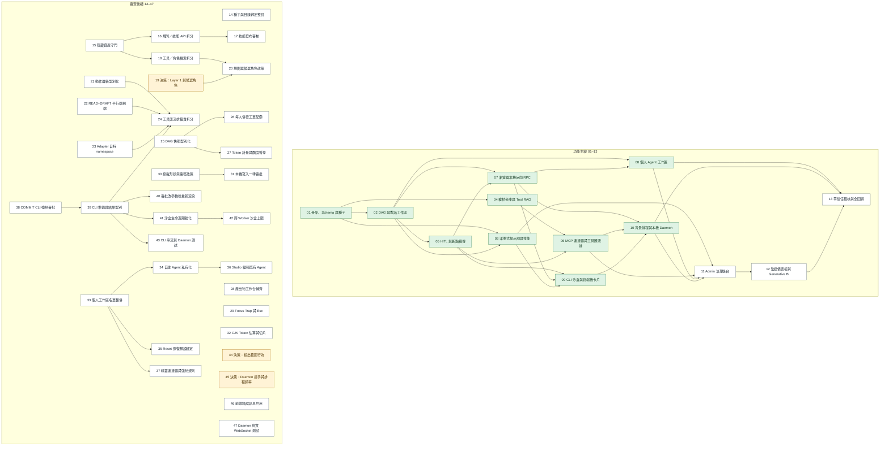

# Enterprise Multi-Agent Platform (`enterprise-agent-platform`)

**Status:** ready-for-agent

## Canonical Specification & Architecture References

- **Master Specification (Living Single Source of Truth)**: [`MASTER_SPEC.md`](../../MASTER_SPEC.md) (`EAMP-MASTER-SPEC-2026-V3.1`)
- **Frontend UI/UX & Interactive State Specification**: [`UI_SPEC.md`](../../UI_SPEC.md) (`EAMP-UI-SPEC-2026-V3.1`)
- **Domain Glossary**: [`GLOSSARY.md`](../../GLOSSARY.md)
- **Product & Accessibility Context**: [`PRODUCT.md`](../../PRODUCT.md)
- **Architecture Decision Records (`docs/adr/`)**:
  - [`0001-configurable-embedding-model-and-dimension.md`](../../docs/adr/0001-configurable-embedding-model-and-dimension.md)
  - [`0002-pluggable-tool-adapters-and-concurrent-runtime.md`](../../docs/adr/0002-pluggable-tool-adapters-and-concurrent-runtime.md)
  - [`0003-per-user-workspace-isolation-and-checkpoint-hibernation.md`](../../docs/adr/0003-per-user-workspace-isolation-and-checkpoint-hibernation.md)
  - [`0004-admin-governance-console-and-generative-bi.md`](../../docs/adr/0004-admin-governance-console-and-generative-bi.md)
- **Default Preset Role Seed Reference**: [`packages/builtin-roles/seed_roles.yaml`](../../packages/builtin-roles/seed_roles.yaml)

---

## Problem Statement

企業內部知識工作者與工程團隊需要一套 100% 機房自建、零機密外洩且商用開源合規的多代理協作平台（Enterprise Agent Hub），但現有方案面臨四大痛點：
1. **工具擴充與個人自主性不足**：除了共通與專屬的 Rules 與 Skills 外，後端工程師缺乏統一的可插拔接口（Tool Adapter）來快速接上新工具或外部 MCP Server，且使用者無法自行勾選要啟用哪些工具，同時大量工具若處理不當會破壞推論 KV Cache 或因循序呼叫拖慢回應。
2. **多人同時在線（Multi-User Concurrency）瓶頸**：單一記憶體連線池無法跨多 Worker 轉發瀏覽器本機檔案反向 RPC，且在等待推論或外部 I/O 期間長佔資料庫連線、或無限制啟動容器沙盒會導致高併發下伺服器塞爆。
3. **登出／關閉 App 後狀態遺失與多使用者互相干擾**：使用者指派任務給專案經理（`PM`）後關閉瀏覽器下班，隔天登入時若未持久化工作階段事件與個人環境設定，就會遺失歷史紀錄與執行狀態；且若多人直接改動同一份全域預設角色，會互相破壞彼此的工作區。
4. **缺乏 100% Web 化的管理員治理後台與 AI 動態統計儀表板（Generative BI）**：管理員需要直接在網頁上新增／刪除／停用帳號、監控並設定每位使用者的 Token 額度（超額時暫停但開通後須能於原對話無縫接續）、管理使用者看不到的底層隱藏（`is_visible_to_user = false`）Rule / Skill / MCP，並能直接以自然語言詢問跨週／跨人比較數據並動態繪製統計圖表。

## Solution

在既有 7 大預設角色範本、Claim-Check 指標、洋蔥式提示詞編譯與三級 HITL 安全閘門底座上，建立：
1. **可插拔 Tool Adapter 三層交集架構與低延遲執行引擎**：提供 Python `@register_tool_adapter` 與動態遠端 MCP / HTTP Webhook 雙軌接口，透過「角色授權 $\cap$ 使用者個人啟用（外加底層強制工具）」決定可用工具；將動態工具 Schema 置於提示詞最尾端（Layer 6）保護 SGLang 前綴快取，並以 `asyncio.gather` 平行呼叫、10 秒獨立斷路器與 Redis 短效讀取快取消除延遲。
2. **多人高併發與零待機休眠執行引擎（Checkpoint Hibernation）**：以 Redis Pub/Sub 打造跨 Worker WebSocket RPC 背板，強制於外部 I/O 期間釋放 DB Session，並在等待人工審批（`WAITING_HITL`）、等待本機連線或等待額度開通（`PAUSED_QUOTA_EXCEEDED`）時將狀態存入 PostgreSQL Checkpoint 後立即釋放 Worker（0% 待機 CPU/RAM）。
3. **個人獨立工作區（User Workspace）與跨登入無縫還原**：每位使用者擁有互不干擾的 Agent 環境（可自由新增、編輯、開關或刪除包含 7 大系統預設角色在內的任何 Agent，並可一鍵 Reset 還原預設範本），支援三種粒度清理記憶，且登入時透過 Bootstrap API 100% 還原上次的對話歷史、進行中工單狀態與本機掛載。
4. **全功能 Admin 治理後台（`/admin`）與 AI 動態繪圖儀表板（Generative BI）**：提供帳號全生命週期 CRUD、Token 配額熔斷與原對話續傳、底層隱藏資產（`is_visible_to_user = false`）線上調優、公開資產上架審核（`PENDING_REVIEW`）、全域工單／排程緊急煞車、資安稽核日誌中心，以及內建 5 大統計報表與支援自然語言唯讀查 DB 動態繪圖的 Generative BI 儀表板。

## User Stories

1. As a **企業員工（User）**, I want to 在對話工作區向主代理（`ORCH`）發起跨領域需求，讓它自動拆解為 DAG 工單交由 `SA`、`ARCH`、`FIN`、`PM` 等角色協作並以 200 字 Claim-Check 指標傳遞交付物, so that 本地模型不會爆 Context 且我能在右側工作台即時預覽完整規格表與 Mermaid 圖表。
2. As a **企業員工（User）**, I want to 指派任務給專案經理（`PM`）後直接關閉瀏覽器或登出下班，隔天重新登入時自動看到完整的歷史對話氣泡、`PM` 的最新執行狀態、產出物與待審批卡片, so that 我的工作進度與個人設定永遠不會因為關閉 App 或重新登入而遺失。
3. As a **企業員工（User）**, I want to 在我個人的獨立工作區內自由新增、編輯、開啟、關閉或刪除任何 Agent（包含系統預設的 7 個角色）而不影響其他同事，並在需要時點擊「還原系統預設 Agent」按鈕或指令一鍵恢復預設角色範本, so that 我能完全客製化自己的代理團隊且隨時有安全的還原退路。
4. As a **企業員工（User）**, I want to 在工具與連接器設定中自由勾選我要啟用或停用哪些 Tools / Connectors（含共通工具與特定角色工具），so that Agent 只會調用我信任且授權的工具。
5. As a **企業員工（User）**, I want to 按「單一角色（如只清 `PM`）」、「單一對話工作階段」或「全部個人私有／本機暫時記憶」清理 Agent 記憶, so that 過期或錯誤的歷史脈絡不會干擾後續任務。
6. As a **企業員工（User）**, I want to 在 Chrome/Edge 免安裝軟體直接掛載本機資料夾供代理讀取 `.docx/.xlsx/.pdf`，並在代理準備寫入本機檔案或發送外部郵件／訊息（`COMMIT` 等級）時，先在紅綠 Diff 視窗或 HITL 審批卡片核准或修改參數後才實際執行, so that 我的電腦檔案與對外發訊百分之百受我掌控。
7. As a **企業員工（User）**, I want to 在對話中途遇到個人 Token 額度用盡時，系統將我的對話與 DAG 進度安全暫停於 `PAUSED_QUOTA_EXCEEDED`，等管理員幫我調高額度後，我能在**同一個對話視窗**直接點擊繼續完成剩餘步驟, so that 我不必重開對話或浪費前面已經跑完的步驟。
8. As a **後端開發工程師（Backend Developer）**, I want to 透過實作統一的 `BaseToolAdapter` 介面（加上 `@register_tool_adapter` 裝飾器）或直接透過管理 API 動態註冊遠端 MCP Server / HTTP Webhook，就能將新工具接上 `UnifiedToolBus`, so that 新增企業內部系統工具時無須修改核心編排邏輯。
9. As a **進階研發工程師（Power User / SE）**, I want to 選配啟動輕量級 `Local MCP Daemon` 或使用伺服器 Rootless Docker 沙盒執行參數化（`shlex.quote` + JSON Schema 驗證）的 CLI 技能，並在右側終端機分頁即時檢視 ANSI 輸出, so that 我能安全地讓代理協助跑測試與驗證規格。
10. As a **平台管理員（Admin）**, I want to 在 `/admin/users` 新增、編輯、停用（立即切斷活躍連線）與刪除使用者帳號（自動連帶銷毀其私有資料與權杖、但保留其已發布至部門或全公司的公共資產，且防止誤刪自己或最後一位管理員），並設定與監控每位使用者的 Token 額度上限, so that 全公司帳號與算力預算都在受控範圍內。
11. As a **平台管理員（Admin）**, I want to 在 `/admin` 線上新增、修正與優化全公司共通以及「一般使用者看不到也關不掉的系統底層隱藏資產（`is_visible_to_user = false` 的 Rules、Skills、MCPs）」與系統預設 Agent 範本，同時審核員工申請公開至 `DEPARTMENT` / `GLOBAL` 的 `PENDING_REVIEW` 資產, so that 我不必改程式碼或重啟伺服器就能持續強化平台底層表現與資安防線。
12. As a **平台管理員（Admin）**, I want to 在 `/admin` 檢視全系統執行中的工單與 24/7 排程（可一鍵強制中止異常任務）、管理全公司與部門共享向量記憶、檢視算力叢集健康度並調整全域預設配額，以及查詢與匯出所有資安攔截與 CLI 稽核日誌, so that 我能即時排除線上異常並滿足企業資安稽核要求。
13. As a **平台管理員（Admin）**, I want to 在 `/admin/dashboard` 檢視 5 大預設統計報表，並能直接輸入自然語言（如「比較某使用者上週跟這週的 Token 花費與角色使用分佈」），由推論伺服器安全撈取資料庫後直接在畫面上動態畫出比較圖表（Grouped Bar / Line / Pie / Table）與文字洞察，且可一鍵釘選至儀表板, so that 我能隨時進行靈活的跨週期與跨部門數據分析。

## Implementation Decisions

1. **增量資料庫結構擴充（保護已完成之 `0001_unified_schema.py`）**：
   - 保持初始 13 張表的 `0001` 遷移穩定，於後續遷移新增與擴充：
     - **`tools_registry`**：記錄可插拔工具與 MCP/Webhook Adapter（含 `code`, `namespace`, `name`, `description`, `input_json_schema`, `action_tier`, `execution_target`, `adapter_type`, `endpoint_config`, `scope_type` (`COMMON_DEFAULT` | `ROLE_SCOPED`), `is_visible_to_user`, `timeout_seconds`, `routing_embedding`, `is_active`）。
     - **`agent_role_tools`**：角色與工具之 M:N 綁定表。
     - **`user_tool_preferences`**：使用者對各工具／命名空間之個人啟用開關（`is_enabled`）與覆寫設定。
     - **`user_agent_configs`**：實現個人獨立工作區（記錄每位 User 對各預設或自建 Agent 的 `is_enabled` 開關、`is_deleted` 隱藏標記、個人化 Prompt / 綁定覆寫），讓 User A 增刪改或關閉預設 Agent 時完全不影響 User B，並支援從 `seed_roles.yaml` 一鍵 Reset。
     - **`chat_sessions` 與 `chat_messages`**：持久化跨次登入的對話階段、綁定掛載、DAG 狀態快照、每一則角色對話氣泡、工具呼叫與產出物事件。
     - **`security_audit_logs` 與 `admin_pinned_widgets`**：記錄所有資安違規攔截事件（路徑穿越、敏感檔讀取、CLI 注入、越權嘗試）及管理員釘選的 Generative BI 動態圖表定義。
     - **`heartbeat_routines`、`user_notifications` 與 `local_daemon_pairings`**（`0007`）：每位使用者的每日排程（`daily_time`、`timezone`、`last_fired_on`）、背景工作通知（登入 Bootstrap 送達、標為已讀後不再出現），以及本機 Daemon 配對（只存權杖的 SHA-256，可撤銷）。
     - **欄位擴充**：於 `users` 擴充 `password_hash`, `token_quota_limit`, `tokens_consumed_total`, `max_concurrent_tickets`, `is_suspended`, `quota_reset_at`；於 `rules_registry` 與 `skills_registry` 擴充 `is_visible_to_user`（預設 `true`）與 `approval_status`；於 `agent_memories` 擴充選填之 `role_code`；於 `tasks_tickets` 擴充 `execution_lane`（`INTERACTIVE` | `BACKGROUND`）。
2. **可插拔 `BaseToolAdapter` 與低延遲高併發 `UnifiedToolBus`**：
   - 所有內建 MCP、Python 程式碼工具與遠端動態 MCP / HTTP Webhook 均實作 `BaseToolAdapter` 介面。
   - 單一角色回合可用工具 = `(COMMON_DEFAULT ∪ agent_role_tools) ∩ user_tool_preferences(is_enabled=true) ∪ system_hidden_mandatory_tools(is_visible_to_user=false)`，再經 `pgvector` HNSW 取 Top-5 置於洋蔥式提示詞最尾端（Layer 6），確保 Layer 1~4 SGLang KV Cache 前綴 100% 跨使用者共享。
   - 同回合多筆 `READ`/`DRAFT` 工具呼叫以 `asyncio.gather()` 平行派發；每個 Adapter 具備獨立 Timeout（預設 `10s`）、連續失敗斷路器（Circuit Breaker）與可選的 Redis 短效讀取快取（TTL `60s`）。
3. **跨 Worker 併發安全與斷點休眠（Checkpoint Hibernation）**：
   - `WebSocketReverseRPCManager` 透過 Redis Pub/Sub 跨多個 FastAPI/Uvicorn Workers 與 Celery Workers 路由瀏覽器與本機 Daemon 反向 RPC。
   - 執行 LLM 推論、MCP 外部 HTTP 或瀏覽器 RPC 等待期間，強制先釋放 SQLAlchemy `AsyncSession`；所有外部 HTTP 共用 Lifespan `httpx.AsyncClient` 連線池；Docker 沙盒以 Semaphore 限制同時執行容器數。
   - 當工單進入 `WAITING_HITL`、`WAITING_BROWSER` 或 `PAUSED_QUOTA_EXCEEDED` 時，狀態寫入 PostgreSQL Checkpoint 後 Worker 立即釋放協程（0% 待機負載），待審批、重連或額度開通後於原對話無縫喚醒。
   - 背景工單由 Celery Worker 以 `SELECT ... FOR UPDATE SKIP LOCKED` 原子認領；`IN_PROGRESS` 且鎖定超過 30 分鐘的工單視為 Worker 已失效並重新認領。Celery Beat 每 60 秒觸發到期排程、每 15 秒掃描背景工單。
   - 本機 Daemon 以配對權杖連線，每個配對有獨立路由（`daemon:<user>:<pairing>`）；撤銷配對時不論 Daemon 連在哪個 Worker 都以 1008 中斷。Daemon 端再次檢查路徑邊界、敏感檔與 CLI 黑名單。
4. **Admin Generative BI 安全唯讀查詢與結構化繪圖**：
   - 管理員自然語言查詢由後端在 PostgreSQL **唯讀交易（`SET TRANSACTION READ ONLY` + `SET LOCAL statement_timeout = '5000ms'`）** 中執行，僅允許查詢經脫敏之統計檢視表／欄位（嚴格排除 `encrypted_access_token`、`encrypted_refresh_token`、`password_hash`），並透過 SGLang 結構化 JSON Schema 回傳 `{ insight_markdown, chart_type, x_axis_key, series, dataset }` 供前端動態繪製圖表。

## Testing Decisions

- **什麼是好測試**：僅針對模組的外部介面（External Behavior）進行測試，驗證輸入、狀態轉換、API 回應、SSE/WebSocket 事件與資料庫持久化解果，不耦合內部私有函式細節。
- **核心測試接縫（Testing Seams）**：
  1. **Seam A — FastAPI ASGI HTTP + WebSocket 外部契約接縫**：涵蓋 Bootstrap 跨登入狀態還原、個人工作區 Agent 增刪開關與一鍵 Reset 隔離、三層記憶清理、Token 超額 `PAUSED_QUOTA_EXCEEDED` 暫停與原對話續傳、Admin 帳號生命週期與離職資產保留、`is_visible_to_user = false` 底層資產遮蔽、`PENDING_REVIEW` 審核、全域工單煞車與 Generative BI 結構化圖表查詢。
  2. **Seam B — `UnifiedToolBus` + `BaseToolAdapter` 匯流排接縫**：涵蓋 Python 與動態遠端 Adapter 掛載、三層工具交集過濾、`asyncio.gather` 平行呼叫延遲驗證、10 秒 Timeout 斷路器、Redis 讀取快取與跨 Worker Redis Pub/Sub WebSocket RPC。
- **既有測試對照（Prior Art）**：延續 `apps/api-server/tests/` 下使用 `pglite` / PostgreSQL 真實資料庫與 `pytest` 非同步測試的風格。

## Out of Scope

- 不修改或替換企業底層 SSO 身分供應商（IdP）伺服器本身（僅透過標準 OIDC/JWT 與後台本機帳號管理對接）。
- 不在平台內建模型微調（Fine-tuning / LoRA 訓練）管線；模型行為調優統一透過洋蔥式 Rules、Skills、預設角色範本與 Few-Shot 範例於 `/admin` 線上完成。

---

## Ticket Task Graph (`.scratch/enterprise-agent-platform/issues/`)

共 47 張 ticket：`01`–`13` 是功能主線，`14`–`47` 是各功能 `/code-review` 後尚未修正的後續項目（標題括號註明來源，例如「審查後續：10」）。

狀態說明：**完成**＝驗收項全部勾選；**待辦**＝`ready-for-agent`；**待決策**＝`ready-for-human`，由人決定後才另開實作 ticket。

### 依賴圖

### 功能主線（01–13）

| # | Ticket | Blocked by | 狀態 |
|---|---|---|---|
| 01 | [`01-platform-skeleton-schema-and-seed.md`](./issues/01-platform-skeleton-schema-and-seed.md) | — | 完成 |
| 02 | [`02-multi-role-dag-claim-check-and-chat-workspace.md`](./issues/02-multi-role-dag-claim-check-and-chat-workspace.md) | `01` | 完成 |
| 03 | [`03-onion-prompt-compiler-and-progressive-skills.md`](./issues/03-onion-prompt-compiler-and-progressive-skills.md) | `01`, `02` | 完成 |
| 04 | [`04-token-vault-and-dynamic-tool-rag.md`](./issues/04-token-vault-and-dynamic-tool-rag.md) | `01` | 完成 |
| 05 | [`05-hitl-security-gate-and-checkpoint-resume.md`](./issues/05-hitl-security-gate-and-checkpoint-resume.md) | `02` | 完成 |
| 06 | [`06-enterprise-mcp-connectors-and-tool-bus.md`](./issues/06-enterprise-mcp-connectors-and-tool-bus.md) | `04`, `05` | 完成 |
| 07 | [`07-browser-local-fs-reverse-rpc-and-diff-write.md`](./issues/07-browser-local-fs-reverse-rpc-and-diff-write.md) | `02`, `05` | 完成 |
| 08 | [`08-self-service-agent-studio-and-mount-privacy.md`](./issues/08-self-service-agent-studio-and-mount-privacy.md) | `02`, `07` | 完成 |
| 09 | [`09-parameterized-cli-sandbox-and-terminal-card.md`](./issues/09-parameterized-cli-sandbox-and-terminal-card.md) | `03`, `05`, `07` | 完成 |
| 10 | [`10-background-heartbeats-atomic-worker-and-local-daemon.md`](./issues/10-background-heartbeats-atomic-worker-and-local-daemon.md) | `06`, `07`, `09` | 完成 |
| 11 | [`11-admin-governance-console-quotas-and-hidden-assets.md`](./issues/11-admin-governance-console-quotas-and-hidden-assets.md) | `03`, `06`, `08`, `10` | 待辦 |
| 12 | [`12-admin-monitoring-dashboard-and-generative-bi.md`](./issues/12-admin-monitoring-dashboard-and-generative-bi.md) | `11` | 待辦 |
| 13 | [`13-zero-trust-security-audit-and-full-regression.md`](./issues/13-zero-trust-security-audit-and-full-regression.md) | `08`, `10`, `12` | 待辦 |

### 審查後續（14–47）

| # | Ticket | 來源 | Blocked by | 狀態 |
|---|---|---|---|---|
| 14 | [`14-consolidate-seed-and-catalog-bindings.md`](./issues/14-consolidate-seed-and-catalog-bindings.md) | 01、04 | — | 待辦 |
| 15 | [`15-hidden-asset-guard-and-typed-approval-status.md`](./issues/15-hidden-asset-guard-and-typed-approval-status.md) | 03、04 | — | 待辦 |
| 16 | [`16-split-rules-skills-api-and-own-activated-skills.md`](./issues/16-split-rules-skills-api-and-own-activated-skills.md) | 03 | `15` | 待辦 |
| 17 | [`17-skill-publishing-enters-pending-review.md`](./issues/17-skill-publishing-enters-pending-review.md) | 03 | `16` | 待辦 |
| 18 | [`18-split-tool-role-retrieval-and-prompt-assembly.md`](./issues/18-split-tool-role-retrieval-and-prompt-assembly.md) | 04 | `15` | 待辦 |
| 19 | [`19-decide-layer1-order-and-candidate-role-policy.md`](./issues/19-decide-layer1-order-and-candidate-role-policy.md) | 03、04 | — | 待決策 |
| 20 | [`20-enforce-candidate-role-policy-in-planner.md`](./issues/20-enforce-candidate-role-policy-in-planner.md) | 04 | `18`, `19` | 待辦 |
| 21 | [`21-typed-action-tier-and-hitl-cleanup.md`](./issues/21-typed-action-tier-and-hitl-cleanup.md) | 05 | — | 待辦 |
| 22 | [`22-single-turn-parallel-read-draft-e2e.md`](./issues/22-single-turn-parallel-read-draft-e2e.md) | 06 | — | 待辦 |
| 23 | [`23-adapters-own-namespace-provider-and-health.md`](./issues/23-adapters-own-namespace-provider-and-health.md) | 06 | — | 待辦 |
| 24 | [`24-split-tool-bus-responsibilities.md`](./issues/24-split-tool-bus-responsibilities.md) | 06 | `21`, `22`, `23`, `39` | 待辦 |
| 25 | [`25-typed-dag-snapshot-and-workspace-restore.md`](./issues/25-typed-dag-snapshot-and-workspace-restore.md) | 02 | — | 待辦 |
| 26 | [`26-enforce-per-user-concurrent-ticket-cap.md`](./issues/26-enforce-per-user-concurrent-ticket-cap.md) | 02、10 | `25` | 待辦 |
| 27 | [`27-token-metering-quota-pause-and-role-status.md`](./issues/27-token-metering-quota-pause-and-role-status.md) | 02 | `25` | 待辦 |
| 28 | [`28-artifact-workbench-copy-mermaid-and-auto-expand.md`](./issues/28-artifact-workbench-copy-mermaid-and-auto-expand.md) | 02 | — | 待辦 |
| 29 | [`29-focus-trap-and-escape-for-dialogs.md`](./issues/29-focus-trap-and-escape-for-dialogs.md) | 02 | — | 待辦 |
| 30 | [`30-single-mount-shape-and-path-policy.md`](./issues/30-single-mount-shape-and-path-policy.md) | 07 | — | 待辦 |
| 31 | [`31-all-local-writes-go-through-hitl-and-audit.md`](./issues/31-all-local-writes-go-through-hitl-and-audit.md) | 07 | `30` | 待辦 |
| 32 | [`32-cjk-token-estimate-and-retrievable-file-slices.md`](./issues/32-cjk-token-estimate-and-retrievable-file-slices.md) | 07 | — | 待辦 |
| 33 | [`33-consolidate-personal-workspace-roster.md`](./issues/33-consolidate-personal-workspace-roster.md) | 08 | — | 待辦 |
| 34 | [`34-custom-agents-are-private-workspace-state.md`](./issues/34-custom-agents-are-private-workspace-state.md) | 08 | `33` | 待辦 |
| 35 | [`35-preset-reset-restores-bindings.md`](./issues/35-preset-reset-restores-bindings.md) | 08 | `33` | 待辦 |
| 36 | [`36-edit-existing-agent-in-studio.md`](./issues/36-edit-existing-agent-in-studio.md) | 08 | `34` | 待辦 |
| 37 | [`37-wizard-connectors-and-locked-mandatory-rules.md`](./issues/37-wizard-connectors-and-locked-mandatory-rules.md) | 08 | `33` | 待辦 |
| 38 | [`38-enforce-commit-cli-approval-in-executor.md`](./issues/38-enforce-commit-cli-approval-in-executor.md) | 09 | — | 待辦 |
| 39 | [`39-consolidate-cli-prepare-and-result-types.md`](./issues/39-consolidate-cli-prepare-and-result-types.md) | 09 | `38` | 待辦 |
| 40 | [`40-rerender-cli-command-after-approval-edit.md`](./issues/40-rerender-cli-command-after-approval-edit.md) | 09 | `39` | 待辦 |
| 41 | [`41-harden-sandbox-lifecycle-and-resources.md`](./issues/41-harden-sandbox-lifecycle-and-resources.md) | 09 | `39` | 待辦 |
| 42 | [`42-cluster-wide-sandbox-concurrency-limit.md`](./issues/42-cluster-wide-sandbox-concurrency-limit.md) | 09 | `41` | 待辦 |
| 43 | [`43-stream-cli-output-and-test-daemon-path.md`](./issues/43-stream-cli-output-and-test-daemon-path.md) | 09 | `39` | 待辦 |
| 44 | [`44-decide-out-of-scope-behaviours-from-review.md`](./issues/44-decide-out-of-scope-behaviours-from-review.md) | 02、07、08、09 | — | 待決策 |
| 45 | [`45-decide-daemon-fallback-and-heartbeat-cadence.md`](./issues/45-decide-daemon-fallback-and-heartbeat-cadence.md) | 10 | — | 待決策 |
| 46 | [`46-shared-error-message-helper-in-web-portal.md`](./issues/46-shared-error-message-helper-in-web-portal.md) | 10 | — | 待辦 |
| 47 | [`47-daemon-real-websocket-end-to-end-test.md`](./issues/47-daemon-real-websocket-end-to-end-test.md) | 10 | — | 待辦 |

### 目前可開工

- **功能主線**：`11`（依賴的 `03`、`06`、`08`、`10` 皆已完成）；`12` 等 `11`，`13` 等 `12`。
- **審查後續（無阻擋）**：`14`、`15`、`21`、`22`、`23`、`25`、`28`、`29`、`30`、`32`、`33`、`38`、`46`、`47`。
- **待人決策**：`19`、`44`、`45`；`20` 需等 `19` 決定。
